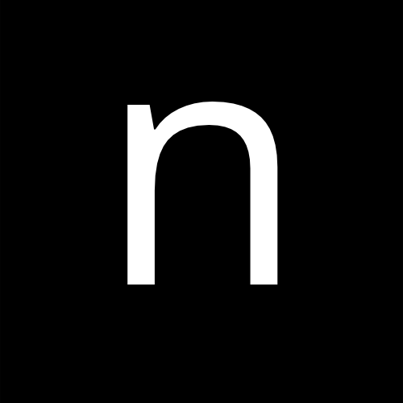

<p align="center">
  
</p>

<h1 align="center">neonano</h1>

<p align="center"><b>Nano, reimagined</b></p>

neonano is a terminal text editor written in C with ncurses. You write in it
the way you would in nano: type, arrow around, Ctrl+S to save. When you need more,
press F1 to open a `:` command palette in the style of vi, run commands, change
settings live, and load plugins. Everything is configurable: colors, themes,
keybinds, line numbers, autosave, and more.

---

## Installation

### Linux

Run this

```
curl -fsSL https://raw.githubusercontent.com/RenCupDotDev/NeoNano/main/install.sh | bash
```

The script needs no source code. It downloads NeoNano from its latest GitHub release, checks the download against GitHub's sha256 for that file, and installs it. Then it asks whether you want the NeoNanoQOL plugins. If you say yes, it lists the plugins in the NeoNanoQOL release, lets you pick them, checks each one the same way, installs them, and enables them in your config.

Requirements: Linux on x86_64, `curl`, `jq`, `sha256sum` and the ncurses wide-character runtime (`libncursesw`).

Run the script again at any time to check for updates. If a newer NeoNano or NeoNanoQOL release exists, it asks before installing it.

To pass options through the pipe, add `-s --` before them:

```
curl -fsSL https://raw.githubusercontent.com/RenCupDotDev/NeoNano/main/install.sh | bash -s -- --qol --qol-plugins dirtree,lsp
```

Or save the script and run it:

```
curl -fsSLO https://raw.githubusercontent.com/RenCupDotDev/NeoNano/main/install.sh
bash install.sh --help
```

### What the script installs

| | User install (default) | System install (`--system`) |
|---|---|---|
| Program | `~/.local/bin/nnano` | `/usr/local/bin/nnano` |
| Plugins | `~/.nnanoplugins/` | `/usr/local/lib/neonano/plugins/` |
| Config | `~/.config/neonano/config.toml` | the config of the user who ran `sudo` |
| Install record | `~/.local/state/neonano/` | `/usr/local/share/neonano/` |

A user install needs no root. A system install needs root (`sudo`), or a writable `--prefix`.

### Options

| Option | What it does |
|---|---|
| (none) | Install NeoNano if it is missing, or offer its update if a newer release exists |
| `--update` | Same as above, but applies updates without asking |
| `--system` | Install system-wide (see the table above) |
| `--prefix DIR` | Root of a system install (default `/usr/local`) |
| `--qol` | Install the NeoNanoQOL plugins, without asking |
| `--no-qol` | Skip the NeoNanoQOL plugins, without asking |
| `--qol-plugins LIST` | Plugins to install, comma-separated, or `all`. Implies `--qol` |
| `--neonano-tag TAG` | Install this NeoNano release instead of the latest one |
| `--qol-tag TAG` | Install this NeoNanoQOL release instead of the latest one |
| `--uninstall` | Remove what the last install put in place |
| `--purge` | Uninstall, and also delete your config and state (asks first) |
| `-n`, `--dry-run` | Print what would happen, and change nothing |
| `-y`, `--yes` | Don't ask questions. Updates and the NeoNanoQOL question take their default answer. `--purge` deletes your config without asking |
| `-h`, `--help` | Show the help |

Examples:

```
./install.sh --dry-run --qol --qol-plugins all   # preview a full install
./install.sh --update --yes                       # update everything without asking
./install.sh --system --qol --qol-plugins all     # system-wide, with every plugin
./install.sh --uninstall                          # remove the program and plugins, keep the config
./install.sh --purge --yes                        # remove everything, including the config
```

### How the install is safe

- Every download is checked against the sha256 that GitHub publishes for that file. A file that doesn't match is never installed.
- If a file already exists where neonano wants to put one, and the install didn't put it there, the script keeps a copy and puts it back on uninstall.
- On uninstall, only the plugin names the install added are turned off in your config. Anything you had enabled before stays enabled.

### Using the editor

The Documentation explains everything, from how to use NeoNano to Making Plugins
